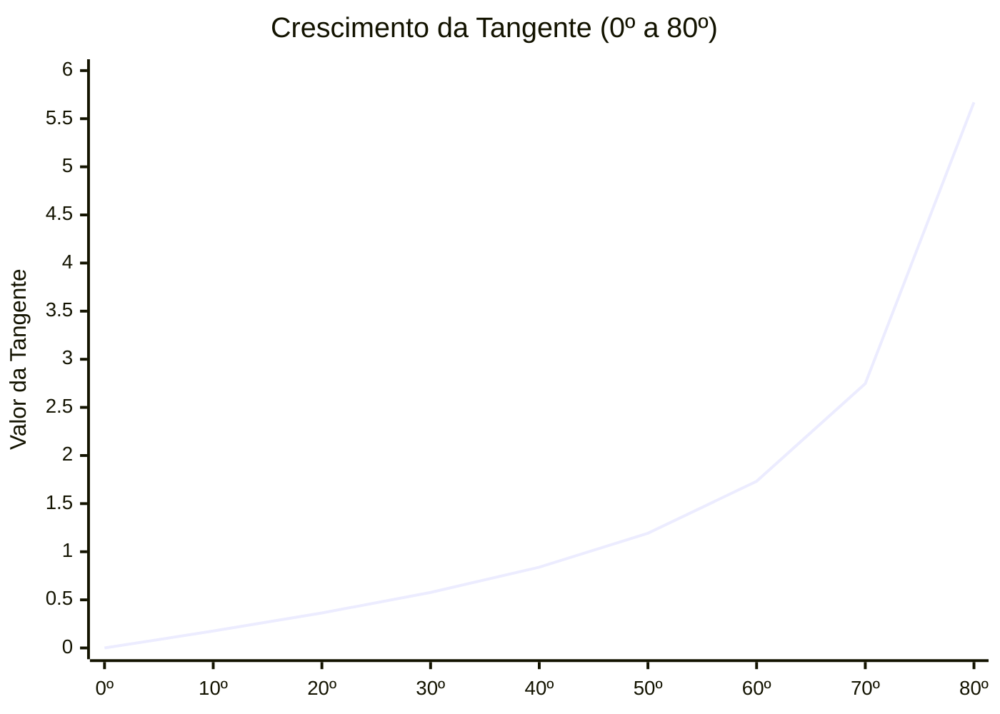

# Unidade 03 – Medidas de distância em Astronomia

## Lição 01 – Calculando a altura de árvores

Damos agora início à terceira unidade do nosso curso, dedicada a um dos maiores desafios da observação espacial: a determinação de distâncias no cosmos. A imensidão do Universo impede o uso de métodos de medição directos; logo, os astrónomos socorrem-se de diversas técnicas indirectas. 

Existem múltiplos métodos para medir distâncias em Astronomia. Curiosamente, uma das estratégias mais úteis para calcular a distância até estrelas situadas no interior da nossa própria galáxia assenta num princípio trigonométrico muito simples. Na verdade, a sua base geométrica é rigorosamente idêntica ao protocolo utilizado no projecto educacional *Globe* para calcular a altura de árvores com o auxílio de uma aplicação móvel.

Para compreendermos a vastidão interestelar, devemos primeiro olhar para o nosso quintal e compreender a matemática por detrás de uma simples árvore.

### 1. O Princípio Geométrico da Observação

Imaginemos a seguinte situação prática: o observador encontra-se diante de uma árvore e deseja determinar a altura exacta da mesma, à qual chamaremos $h$.

Para o efeito, o observador realiza dois passos fundamentais:
1.  **Mede a distância horizontal:** Caminha desde a sua posição inicial até à base do tronco da árvore, seja contando os passos ou utilizando uma fita métrica. A esta distância linear chamamos $d$.
2.  **Mede o ângulo de elevação:** Utilizando um instrumento de medição angular ou uma aplicação no telemóvel, o observador aponta para o topo da árvore e regista o ângulo visualizado. A este ângulo damos o nome de $\alpha$.

Esta disposição geométrica forma uma figura basilar da matemática clássica: um triângulo.

```tikz
\begin{tikzpicture}[scale=1.2]
    % Representação do Observador (Olho)
    \draw[thick] (-0.5, 0) ellipse (0.35 and 0.15);
    \fill[black] (-0.5, 0) circle (0.1);
    \node[below, font=\scriptsize] at (-0.5, -0.2) {Observador};

    % Distância Horizontal (d)
    \draw[ultra thick, black] (0,0) -- (4,0) node[midway, below=5pt, font=\bfseries, scale=1.2] {d};
    
    % Altura da Árvore (h)
    \draw[ultra thick, green!60!black] (4,0) -- (4,2.5) node[midway, right=5pt, font=\bfseries, scale=1.2] {h};
    
    % Linha de Visão (Hipotenusa)
    \draw[ultra thick, blue] (0,0) -- (4,2.5);
    
    % Ângulo (alpha)
    \draw[thick] (0.8,0) arc (0:32:0.8);
    \node[font=\bfseries, scale=1.2] at (1.15, 0.25) {$\alpha$};
    
    % Símbolo de Ângulo Reto
    \draw[thick] (3.7,0) -- (3.7,0.3) -- (4,0.3);
    \fill[black] (3.85,0.15) circle (0.03);
    
    % Árvore (Simbolismo extra)
    \node[green!50!black, font=\bfseries] at (4.5, 2.7) {Topo da \'arvore};
\end{tikzpicture}
```

### 2. O Triângulo Rectângulo e o Teorema de Pitágoras

A figura delineada pelas nossas medições é um **triângulo rectângulo**. Ele recebe esta denominação porque o ângulo formado entre o solo (a distância $d$) e o tronco da árvore (a altura $h$) é um ângulo recto, isto é, de exactamente $90^\circ$. Nos esquemas matemáticos, este ângulo é universalmente sinalizado por um pequeno quadrado com um ponto no centro.

A trigonometria dita que um triângulo fica completamente especificado se conhecermos dois dos seus lados e um ângulo (neste caso, o ângulo recto de $90^\circ$). Os dois lados que formam o ângulo recto (neste exemplo, $d$ e $h$) recebem o nome de **catetos**. O lado maior, que une o observador ao topo da árvore e se opõe ao ângulo recto, denomina-se **hipotenusa** (representada pela letra $a$).

Se, porventura, conhecêssemos o valor numérico dos dois catetos ($d$ e $h$), poderíamos facilmente determinar o comprimento da linha de visão ($a$) socorrendo-nos do célebre **Teorema de Pitágoras**:

$$ a^2 = d^2 + h^2 $$

No entanto, no nosso exercício prático no terreno, a altura $h$ é precisamente a incógnita que desconhecemos e pretendemos descobrir. Conhecemos apenas um cateto ($d$) e o ângulo $\alpha$. 

### 3. Semelhança de Triângulos e Proporcionalidade

Como podemos, então, descobrir $h$ possuindo apenas uma distância ($d$) e um ângulo ($\alpha$)? A resposta repousa num dos conceitos mais belos da geometria: a **proporcionalidade** por semelhança de triângulos.

Se desenharmos um triângulo mais pequeno (cujos lados chamaremos de $h'$ e $d'$) que partilhe rigorosamente o mesmo ângulo $\alpha$ do triângulo maior, constatamos que eles são triângulos semelhantes. Num conjunto de triângulos semelhantes, a razão (ou divisão) entre a altura e a base mantém-se perpetuamente constante, independentemente da escala.

A expressão matemática que ilustra esta equivalência é:

$$ \frac{h}{d} = \frac{h'}{d'} $$

```tikz
\begin{tikzpicture}[scale=1.5]
    % Triângulo Maior (Preto)
    \draw[ultra thick, black] (0,0) -- (4,0) node[midway, below=8pt, font=\bfseries, scale=1.2] {d};
    \draw[ultra thick, black] (4,0) -- (4,2.5) node[midway, right=5pt, font=\bfseries, scale=1.2] {h};
    \draw[ultra thick, black] (0,0) -- (4,2.5);
    
    % Triângulo Menor (Azul)
    \draw[ultra thick, blue] (2.5,0) -- (2.5, 1.56) node[midway, left=2pt, font=\bfseries, scale=1.1] {h'};
    \draw[ultra thick, blue] (0,0) -- (2.5,0) node[midway, above=2pt, font=\bfseries, scale=1.1] {d'};
    
    % Ângulo Partilhado
    \draw[thick] (0.7,0) arc (0:32:0.7);
    \node[font=\bfseries, scale=1.4] at (1.1, 0.25) {$\alpha$};
    
    % Ângulos Retos
    \draw[thick] (3.8,0) -- (3.8,0.2) -- (4,0.2);
    \fill[black] (3.9,0.1) circle (0.02);
    
    \draw[thick, blue] (2.3,0) -- (2.3,0.2) -- (2.5,0.2);
    \fill[blue] (2.4,0.1) circle (0.02);
\end{tikzpicture}
```

### 4. A Tangente do Ângulo

A divisão descrita acima não é um número arbitrário; é uma propriedade intrínseca ao ângulo. Na matemática, a divisão do cateto oposto ao ângulo pelo cateto adjacente ao mesmo ângulo recebe a denominação de **Tangente** ($tg$).

Assim, formalizamos a função trigonométrica:

$$ tg(\alpha) = \frac{h}{d} = \frac{h'}{d'} = \frac{\mathrm{cateto\ oposto}}{\mathrm{cateto\ adjacente}} $$

Os valores das tangentes para cada ângulo estão tabelados desde a antiguidade e, hoje em dia, podem ser consultados de imediato em calculadoras científicas (ou no próprio telemóvel, colocando-o na horizontal). Sabemos, por exemplo, que se o ângulo medido for de $45^\circ$, a sua tangente tem o valor exacto de $1$, o que significaria que a distância $d$ é rigorosamente igual à altura $h$.

A tabela abaixo exibe os valores das tangentes para diversos ângulos observacionais:

| Ângulo ($\alpha$) | Tangente ($tg$) |       | Ângulo ($\alpha$) | Tangente ($tg$) |
| :---------------: | :-------------: | :---: | :---------------: | :-------------: |
|    0 $^\circ$     |      0,000      |       |    50 $^\circ$    |      1,192      |
|    5 $^\circ$     |      0,087      |       |    55 $^\circ$    |      1,428      |
|    10 $^\circ$    |      0,176      |       |    60 $^\circ$    |      1,732      |
|    15 $^\circ$    |      0,268      |       |    65 $^\circ$    |      2,145      |
|    20 $^\circ$    |      0,364      |       |    70 $^\circ$    |      2,747      |
|    25 $^\circ$    |      0,466      |       |    75 $^\circ$    |      3,732      |
|    30 $^\circ$    |      0,577      |       |    80 $^\circ$    |      5,671      |
|    35 $^\circ$    |      0,700      |       |    85 $^\circ$    |     11,430      |
|    40 $^\circ$    |      0,839      |       |    89 $^\circ$    |     57,290      |
|    45 $^\circ$    |      1,000      |       |    90 $^\circ$    |    Infinito     |

O crescimento vertiginoso do valor da tangente (que tende para o infinito à medida que a observação se aproxima dos $90^\circ$) pode ser visualizado no gráfico que se segue:



### 5. A Fórmula Final da Altura

Munidos da equação da tangente, resolver o nosso problema de campo torna-se num trivial exercício de álgebra. Se conhecemos a tangente do ângulo (dada pela máquina) e a distância (medida por nós), basta isolar a altura ($h$) na equação, passando a distância ($d$) para o outro lado do sinal de igualdade a multiplicar:

$$ tg(\alpha) = \frac{h}{d} \quad \Longrightarrow \quad h = d \cdot tg(\alpha) $$

É exactamente este o algoritmo interno que o software do projecto *Globe* executa de forma automática e invisível no telemóvel do utilizador: ele capta o grau de inclinação, recorre a uma tabela de trigonometria interna para averiguar a tangente, e multiplica-a pela distância informada pelo operador, desvendando assim a altura da árvore sem que ninguém necessite de a escalar.

Na próxima lição, transpores esta sublime ferramenta da escala terrestre dos bosques para as vertiginosas profundezas interestelares da nossa Galáxia, demonstrando como a mesma matemática da árvore mede a distância de estrelas cintilantes.