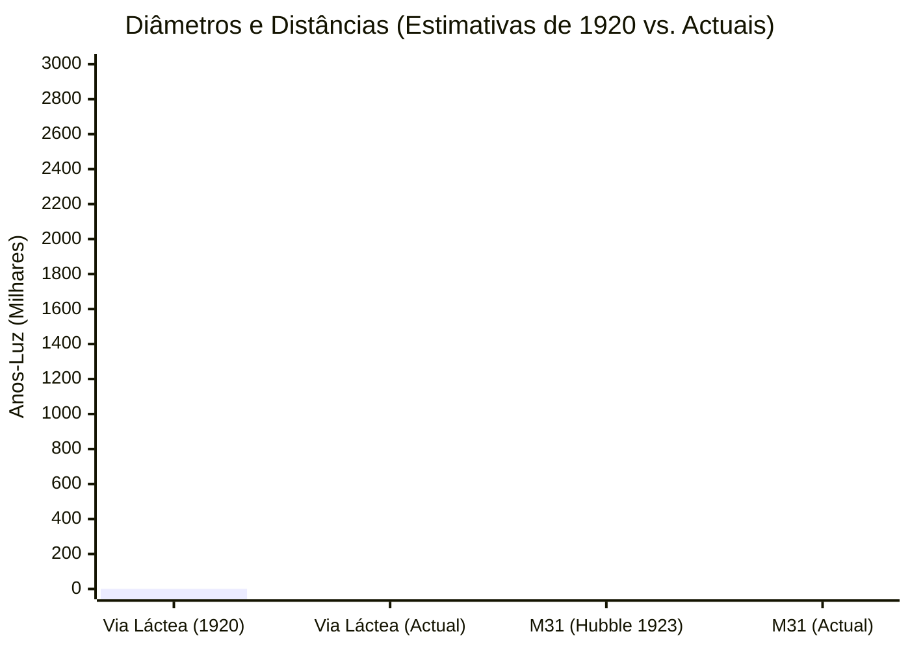

# Unidade 03 – Medidas de distância em Astronomia

## Lição 05 – Astronomia em 1920

A descoberta de Henrietta Leavitt municiou a astronomia com uma poderosa «régua cósmica». Contudo, para compreendermos o verdadeiro impacto tectónico que as Estrelas Cefeidas tiveram na ciência, precisamos de recuar no tempo e mergulhar no panorama intelectual que vigorava na década de 1920. 

Esta quinta lição leva-nos a uma época em que o cosmos, na mente dos seres humanos, era assombrosamente mais pequeno do que a realidade que hoje conhecemos.

### 1. O Universo Conhecido em 1920 e o «Grande Debate»

Há cerca de um século, o conhecimento astrofísico ditava que **o Universo inteiro consistia única e exclusivamente na nossa própria galáxia: a Via Láctea**. Acreditava-se que o Sistema Solar, as miríades de estrelas cintilantes e os cometas esgotavam a totalidade do que existia no vazio espacial.

No entanto, as observações ao telescópio revelavam a presença de objectos difusos, lúgubres e sem forma definida aos quais se deu o nome de **«nebulosas»**. Existia, na época, um debate fervoroso entre os maiores astrónomos do mundo para descortinar a verdadeira natureza destas estruturas. A comunidade dividia-se em duas facções teóricas:

1. Uma defendia que estas nebulosas eram meras **nuvens de gás** a flutuar dentro dos limites da Via Láctea.
2. A outra argumentava que se tratavam de **«universos-ilha»** — vastos aglomerados de estrelas e planetas, completamente separados da nossa galáxia e situados a distâncias inimagináveis.

A incapacidade de resolver este enigma devia-se a uma limitação técnica gritante: a paralaxe estelar (o método trigonométrico que abordámos nas primeiras lições) era totalmente inútil para estes objectos. As nebulosas não exibiam qualquer desvio angular com o movimento de translação da Terra, indiciando que se encontravam a distâncias colossalmente fora do alcance dos nossos instrumentos de medição trigonométrica.

### 2. O Telescópio de Mount Wilson e a Lente de Edwin Hubble

O impasse apenas seria quebrado no ano de 1923 pelo génio prático do astrónomo **Edwin Hubble** (cujo nome viria a baptizar o mais célebre telescópio espacial da nossa era). 

Hubble dispunha de uma vantagem tecnológica ímpar: trabalhava no Observatório de *Mount Wilson*, nos Estados Unidos da América, operando o telescópio mais poderoso e formidável do mundo à época. Este instrumento colossal ostentava um espelho reflector primário de **$2,5\,\mathrm{m}$ de diâmetro**. Na óptica astrofísica, quanto maior for a envergadura do espelho, maior é a capacidade de captação de luz ténue, permitindo perscrutar detalhes que escapariam a qualquer outro equipamento.

### 3. A Descoberta da Cefeida na Nebulosa M31

Ao apontar o seu monumental telescópio para a célebre nebulosa catalogada como **M31**, Hubble começou a tirar múltiplas fotografias da mesma região do céu em noites sucessivas. Antes da era digital, a astronomia dependia inteiramente de placas fotográficas de vidro expostas à luz durante longas horas.

Ao comparar rigorosamente duas destas placas captadas em instantes temporais distintos, Hubble deparou-se com um fenómeno assombroso. Numa das extremidades da nebulosa M31, havia um minúsculo ponto luminoso que não se encontrava lá na fotografia anterior. 

Inicialmente, ele supôs tratar-se de uma estrela que havia explodido — uma nova. Com o seu próprio punho, assinalou a placa fotográfica com a letra **«N»**. Contudo, ao continuar as suas observações nas noites subsequentes, ele percebeu que a estrela sumia e reaparecia de forma cíclica e ininterrupta. 

Perante a evidência inequívoca da pulsação rítmica, Hubble riscou a letra «N» e escreveu efusivamente a abreviatura **«VAR!»** (Variável). Ele acabara de encontrar uma Estrela Cefeida no seio daquela nebulosa! 

Abaixo ilustramos, através de um diagrama, a histórica e célebre marcação efectuada na placa de vidro por Edwin Hubble:

```tikz
\begin{tikzpicture}[scale=1.2]
    % Fundo da Placa Fotográfica
    \fill[black!85] (0,0) rectangle (7,4.5);
    
    % Brilho da Nebulosa M31
    \fill[white!90, opacity=0.8] (3.5, 1.8) ellipse (1.5 and 0.8);
    \fill[white!60, opacity=0.5] (3.5, 1.8) ellipse (2.2 and 1.2);
    \fill[white!30, opacity=0.2] (3.5, 1.8) ellipse (3.0 and 1.6);
    
    % Estrelas de Fundo
    \foreach \x/\y in {0.5/4, 1.2/3.8, 0.8/1.2, 6.5/4.2, 6.2/0.8, 1.5/0.5, 5.5/1.2, 3.5/4.0} {
        \fill[white] (\x,\y) circle (0.03);
    }
    
    % A Cefeida
    \node[star, star points=5, star point ratio=2, fill=white, inner sep=1.5pt] (cefeida) at (5.2, 3.5) {};
    
    % As marcações originais de Hubble
    % O "N" riscado
    \node[white, font=\bfseries] at (6.0, 3.5) {N};
    \draw[ultra thick, white] (5.8, 3.3) -- (6.2, 3.7);
    \draw[ultra thick, white] (5.8, 3.7) -- (6.2, 3.3);
    
    % A palavra "VAR!"
    \node[white, font=\bfseries\Large] at (6.0, 2.8) {VAR!};
    
    % Linhas a apontar para a estrela
    \draw[thick, white] (5.5, 3.5) -- (5.8, 3.5);
    \draw[thick, white] (5.2, 3.2) -- (5.2, 2.9);
    
    % Anotação do diagrama
    \node[white, font=\scriptsize, align=left] at (1.5, 0.3) {Recria\c{c}\~ao da Placa de Vidro de\\E. Hubble (M31 - 1923)};
\end{tikzpicture}
```

### 4. O Triunfo da Matemática e a Ampliação do Cosmos

Aplicando os preceitos teóricos ditados pela falecida Henrietta Leavitt, Hubble cronometrou o período de variação daquela Cefeida em M31 e determinou o seu brilho intrínseco. Munido desse dado, e comparando-o com o brilho ténue captado pelo espelho de $2,5\,\mathrm{m}$, a matemática permitiu-lhe deduzir a distância absoluta.

Os cálculos de 1923 revelaram que a M31 se encontrava à estarrecedora distância de **$900.000\,\mathrm{anos-luz}$**. 

O impacto deste valor numérico foi revolucionário. Para compreender o abalo sísmico que isto provocou na comunidade científica, precisamos de atentar às medidas da época:
* Estimava-se que o diâmetro total da Via Láctea seria inferior a $300.000\,\mathrm{anos-luz}$.
* Se a M31 estava a $900.000\,\mathrm{anos-luz}$, ela encontrava-se quase três vezes mais distante do que os próprios confins da nossa galáxia!

A conclusão era de uma insofismável clareza geométrica: **A M31 não era uma nuvem de gás confinada à Via Láctea; era, de facto, um «universo-ilha», uma galáxia majestosa e inteiramente independente, tal como a nossa.** Hoje, a M31 é mundialmente conhecida como a **Galáxia de Andrómeda**.

*(Nota de rigor histórico: Com o refinamento da calibração instrumental ao longo das décadas, sabemos hoje que a Via Láctea é consideravelmente mais estreita do que se pensava — com cerca de $85.000\,\mathrm{anos-luz}$ de diâmetro — e que a Galáxia de Andrómeda está ainda mais distante — a espantosos $2,5\,\mathrm{milh\tilde{o}es}$ de anos-luz. Os erros de cálculo iniciais de Hubble não obliteram, todavia, a validade e a grandiosidade da sua dedução fundamental).*

O gráfico que se segue consubstancia a disparidade formidável entre as estimativas históricas da década de 1920 e os valores consolidados pela astrofísica moderna:



Nesse instante, o Universo deixou de ser uma estrutura única (a Via Láctea) para se transmutar num abismo incomensurável, povoado por centenas de milhares de milhões de galáxias. 

### 5. O Esclarecimento Taxonómico das «Nebulosas»

O corolário desta lição prende-se com a clarificação semântica do léxico astronómico. Nem todas as manchas difusas a que os antigos chamavam «nebulosas» eram galáxias. Com a evolução da óptica e o poder de resolução dos novos telescópios, a astronomia destrinçou finalmente o que se escondia sob esse manto generalista:

1. **Galáxias:** Estruturas colossais compostas por milhares de milhões de estrelas fora da Via Láctea (exemplo: a galáxia espiral **M101** e a própria **M31 / Andrómeda**).
2. **Aglomerados Globulares:** Enxames incrivelmente densos de centenas de milhares de estrelas muito antigas que nasceram e evoluem juntas, orbitando como um só corpo gravitacional (exemplo: **M80**).
3. **Nebulosas Planetárias e Remanescentes de Supernovas:** Estas, sim, são autênticas nuvens de gás e poeira no interior da nossa galáxia, correspondendo aos restos dilacerados de estrelas defuntas que explodiram violentamente (exemplo: **M1 / Nebulosa do Caranguejo**).

*(Recomendação de Estudo: Sugiro veementemente que o estudante consulte os arquivos fotográficos digitais do Telescópio Espacial Hubble e da Agência Espacial Europeia (ESA) para visualizar as imagens contemporâneas de **M31**, **M1**, **M80** e **M101**, de modo a contemplar o abismo visual de resolução óptica que medeia entre os nossos instrumentos actuais e as placas de vidro trémulas do século passado).*

E assim, através da humilde pulsação de uma Estrela Cefeida e do trabalho imortal de figuras como Leavitt e Hubble, a humanidade descerrou a cortina e testemunhou, pela primeira vez na sua história, a verdadeira e aterradora dimensão do Universo em que habitamos.