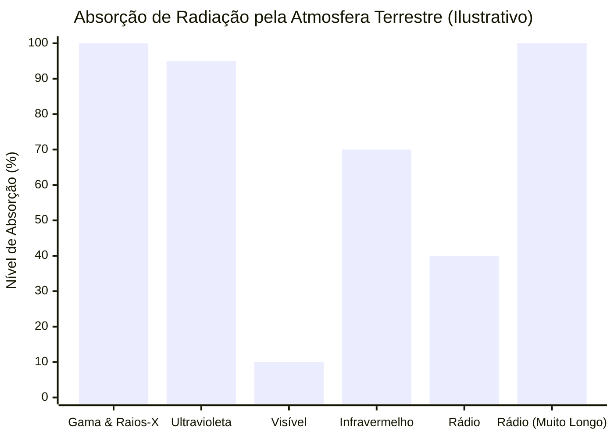

# Unidade 03 – Medidas de distância em Astronomia

## Lição 06 – A luz e o espetro electromagnético

Antes de avançarmos para o cálculo das estonteantes velocidades com que as galáxias se afastam umas das outras no abismo cósmico, é imperativo compreendermos o veículo fundamental que nos traz essa mesma informação. Quase a totalidade do conhecimento empírico que possuímos em Astronomia deriva de um único e extraordinário mensageiro: **a luz**.

A excepção a esta regra de ouro recai sobre as ondas gravitacionais (distorções na própria malha do espaço-tempo), um tópico avançado que será abordado nas lições finais do curso. Contudo, para o estudo clássico e observacional do Universo, podemos assumir que radiação, luz e fotões são sinónimos do mesmo fenómeno basilar.

### 1. A Natureza Ondulatória da Luz e os Fotões

A luz é composta por partículas elementares desprovidas de massa de repouso, às quais outorgamos o nome de **fotões** (ou «fótons» na variante brasileira). A peculiaridade quântica destas partículas é que elas se comportam e propagam pelo espaço sob a forma de uma **onda**.

Para ilustrar este conceito, o docente propõe uma analogia mecânica de fácil compreensão terrena: imaginemos uma corda atada a um gancho na parede. Ao oscilarmos a extremidade livre da corda para cima e para baixo com a nossa mão, geramos uma perturbação mecânica que viaja ao longo de toda a extensão do material. A luz obedece a um padrão de propagação formidavelmente semelhante, com uma distinção capital: **a luz não necessita de um meio material para se propagar**. Ao contrário da corda, do som (que requer ar ou água) ou das ondas do mar, a radiação electromagnética viaja incólume através do vazio absoluto (vácuo) do espaço interestelar.

### 2. O Comprimento de Onda ($\lambda$)

Ao observarmos uma onda a propagar-se, notamos a existência de picos máximos (as cristas) e vales. Na Física e na Astronomia, a distância rectilínea que medeia entre duas perturbações consecutivas (ou seja, de uma crista até à crista imediatamente seguinte) é denominada **comprimento de onda**, universalmente representado pela letra grega **$\lambda$ (lambda)**.

```tikz
\begin{tikzpicture}[scale=1.2, transform shape]
    % Fundo
    \fill[white] (-1, -2) rectangle (9, 2);
    
    % Parede e Argola
    \fill[gray!70!black] (8.5, -1.5) rectangle (8.8, 1.5);
    \draw[ultra thick, gray] (8.3, 0) circle (0.2);
    
    % A Onda (Corda)
    \draw[ultra thick, blue!80!black] (0,0) sin (1,1) cos (2,0) sin (3,-1) cos (4,0) sin (5,1) cos (6,0) sin (7,-1) cos (8,0);
    
    % Marcação do Comprimento de Onda (Lambda)
    \draw[|<->|, ultra thick, red] (1, 1.3) -- (5, 1.3);
    \node[above, font=\bfseries\Large, text=red] at (3, 1.4) {$\lambda \ (\mathrm{Comprimento\ de\ Onda})$};
    
    % Vector de Velocidade de Propagação
    \draw[->, line width=3pt, blue] (3, -1.7) -- (5, -1.7);
    \node[below, font=\bfseries, text=blue] at (4, -1.8) {Velocidade de Propaga\c{c}\~ao};
    
    % Mão / Perturbação Inicial (Simbólico)
    \draw[<->, ultra thick, black!70] (-0.3, -0.8) -- (-0.3, 0.8);
    \node[left, font=\scriptsize, align=center] at (-0.4, 0) {Oscila\c{c}\~ao\\(Fonte)};
\end{tikzpicture}
```

Dependendo da frequência com que a perturbação é gerada, podemos obter ondas com comprimentos enormes (ondas longas e lânguidas) ou ondas com comprimentos minúsculos (frequências muito elevadas, com as cristas fortemente comprimidas umas contra as outras).

### 3. O Espectro Visível e a Percepção Humana das Cores

A forma como o cérebro e os olhos do ser humano percepcionam as diferentes distâncias entre as cristas da onda luminosa manifesta-se através daquilo a que chamamos **cor**. 

O comprimento de onda da luz visível é tão microscopicamente diminuto que os astrónomos recorrem a uma unidade de medida específica: o **nanómetro ($\mathrm{nm}$)**. 
A relação matemática desta unidade para com o metro obedece à seguinte expressão analítica:

$$ 1\,\mathrm{nm} = 0,000000001\,\mathrm{m} = 10^{-9}\,\mathrm{m} $$

A luz visível reparte-se numa faixa que se estende sensivelmente dos $400\,\mathrm{nm}$ aos $750\,\mathrm{nm}$:

*   **Azul e Violeta:** Comprimentos de onda menores ($\lambda \simeq 400\,\mathrm{nm}$ a $440\,\mathrm{nm}$).
*   **Verde:** Comprimentos intermédios ($\lambda \simeq 520\,\mathrm{nm}$).
*   **Amarelo:** ($\lambda \simeq 580\,\mathrm{nm}$).
*   **Vermelho:** Comprimentos de onda maiores ($\lambda \simeq 680\,\mathrm{nm}$).

```tikz
\begin{tikzpicture}[scale=1.1, transform shape, 
    every node/.style={font=\rmfamily}  % Serif font (use \kurinto if available)
]
    % Escala e Eixo (alargado até 13)
    \draw[->, thick, black] (0, 0) -- (13, 0) node[right, font=\bfseries\rmfamily] {$\lambda\ (\mathrm{nm})$};
    
    % Preenchimento de Cor (Espectro Visível)
    \shade[left color=blue!60!violet, right color=blue]     (1, 0.2) rectangle (3.5, 1.2);
    \shade[left color=blue, right color=green]               (3.5, 0.2) rectangle (6, 1.2);
    \shade[left color=green, right color=yellow]             (6, 0.2) rectangle (8.5, 1.2);
    \shade[left color=yellow, right color=orange]            (8.5, 0.2) rectangle (10.5, 1.2);
    \shade[left color=orange, right color=red]               (10.5, 0.2) rectangle (12.5, 1.2);
    
    % Marcações no Eixo
    \foreach \x/\val in {1/400, 6/500, 8.5/600, 12.5/700} {
        \draw[thick, black] (\x, 0) -- (\x, -0.2);
        \node[below, font=\footnotesize\bfseries\rmfamily] at (\x, -0.2) {$\val\,\mathrm{nm}$};
    }
    
    % Etiquetas de Cores e Valores Típicos (mais espaçadas)
    \node[blue!80!black, font=\bfseries\rmfamily] at (2.25, 1.5) {Azul ($\sim 440\,\mathrm{nm}$)};
    \node[green!60!black, font=\bfseries\rmfamily] at (6.25, 1.5) {Verde ($\sim 520\,\mathrm{nm}$)};
    \node[orange!90!black, font=\bfseries\rmfamily] at (10.5, 1.5) {Vermelho ($\sim 680\,\mathrm{nm}$)};
\end{tikzpicture}
```

<!--  -->


### 4. O Espectro Electromagnético Completo

A grande interrogação que emerge é iniludível: *E o que existe além destas fronteiras? O que acontece se a onda for menor que $400\,\mathrm{nm}$ ou maior que $750\,\mathrm{nm}$?*

Embora os nossos olhos sejam completamente cegos a essas manifestações luminosas, o Universo encontra-se permeado por fótons que vibram a essas frequências ocultas. Ao conjunto de todas as formas e comprimentos sob os quais a luz pode existir, damos a designação de **Espectro Electromagnético**.

*   **Comprimentos diminutos (Altamente Energéticos):** Se avançarmos para comprimentos de onda substancialmente menores que a luz azul e violeta, entraremos no domínio da luz **Ultravioleta**, seguindo-se os **Raios-X** e culminando nos poderosíssimos e letais **Raios Gama** ($\lambda \simeq 0,0001\,\mathrm{nm}$). Estes fotões contêm uma energia devastadora.
*   **Comprimentos alongados (Baixa Energia):** Se, em contrapartida, ultrapassarmos o limiar da luz vermelha, adentramos a vasta faixa do **Infravermelho**, passando posteriormente para as Micro-ondas, até desembocarmos nas colossais **Ondas de Rádio**. As ondas de rádio podem ostentar distâncias entre cristas que oscilam entre alguns centímetros até mais de $100\,\mathrm{metros}$ de comprimento.

### 5. O Escudo Atmosférico e a Evolução Biológica

A observação astronómica destas diversas radiações a partir da superfície terrestre enfrenta um formidável obstáculo: a nossa própria atmosfera. 

A atmosfera do planeta Terra actua como um cobertor térmico e protector. Ela possui janelas de transparência, mas também formidáveis blocos de opacidade:

1.  **Bloqueio Total:** Todos os Raios Gama, Raios-X e grande parte da radiação Ultravioleta são absorvidos nas altas camadas atmosféricas. Felizmente para o Homem, esta absorção impede que as radiações ionizantes aniquilem as frágeis cadeias moleculares biológicas à superfície.
2.  **Janelas Transparentes:** A atmosfera permite a passagem imaculada da **Luz Visível** e de uma vasta fracção das **Ondas de Rádio**. Partes intermitentes do Infravermelho também logram trespassar o ar.

Como sagazmente pontuou o docente, há uma elegância poética subjacente à teoria evolutiva de Darwin no que a este fenómeno concerne. O ser humano não desenvolveu olhos sensíveis à radiação Gama ou aos Raios-X; os nossos receptores oculares evoluíram precisamente para captar a faixa da «luz visível» por uma razão avassaladoramente simples: **era essa a única fatia expressiva do espectro luminoso que conseguia perfurar a atmosfera e banhar a superfície do planeta onde as espécies prosperaram**.



### 6. Os Diferentes Olhos da Astronomia Moderna

A constatação de que grande parte do Universo resplandece em "cores" que a atmosfera bloqueia, forçou a engenharia astrofísica a desenvolver soluções díspares:

*   **Observatórios Terrestres:** Para o espectro Visível, constroem-se baterias de telescópios em cumes montanhosos altíssimos e áridos — como o *Cerro Tololo*, no Chile — para mitigar a interferência residual do ar. Para a rádio-astronomia, que não é afectada pela atmosfera, erguem-se vastos campos de antenas e pratos parabólicos nos desertos limpos, como é o caso das instalações ALMA no deserto de Atacama.
*   **Telescópios Espaciais:** Contudo, se ambicionamos escrutinar o cosmos em Raios-X, Gama, Ultravioleta ou no Infravermelho profundo, não há montanha que nos valha. É obrigatório colocar os instrumentos no vazio gelado fora do globo. Exemplo máximo desta epopeia técnica é o lendário **Telescópio Espacial Hubble** (e o seu sucessor contemporâneo, o Telescópio James Webb, focado primordialmente no infravermelho).

### 7. O «Mapa Mundi» do Universo Visível e Invisível

Quando compilamos as observações de todos estes instrumentos díspares e projectamos a totalidade do firmamento numa abóbada em forma oval (semelhante aos planisférios ou «mapas mundi» da geografia clássica terrena), testemunhamos revelações assombrosas.

*(Sugere-se vivamente ao estudante a consulta destas projecções nos arquivos digitais acessíveis através das hiperligações sugeridas nos materiais complementares da Agência Espacial Europeia – ESA – e da NASA, particularmente os mapas interactivos do céu capturados por sondas como o Gaia e o Planck).*

A Via Láctea — o brilhante disco achatado em cujo interior repousamos — encontra-se invariavelmente proeminente como um feixe rasgado através do equador da imagem, cortando o céu a meio. Contudo, ao alterar a "cor" da observação, a face da galáxia transfigura-se:

*   Em **Raios-X e Raios Gama**, o céu nocturno é iluminado por núcleos estelares violentos, buracos negros a devorar matéria, e restos turbulentos de supernovas (pulsares e estrelas de neutrões).
*   No **Infravermelho**, a espessa poeira estelar — que encobre e eclipsa a luz visível — torna-se diáfana e fluorescente, permitindo vislumbrar o coração ígneo e obscurecido da nossa galáxia.
*   Nas **Micro-ondas** (um sub-espectro do rádio), o telescópio revela algo ainda mais arcaico que as estrelas: a **radiação cósmica de fundo**. Um eco térmico fossilizado, mosqueado em cores ténues, que testemunha os instantes primordiais que se seguiram imediatamente ao «Big Bang». 

Estas diferentes perspectivas asseguram que, ao fragmentar a luz no seu espectro total, não estamos meramente a capturar fotografias coloridas do céu; estamos, efectivamente, a dissecar a temperatura, a química, o passado convulsivo e o inexorável futuro da maquinaria do Universo.