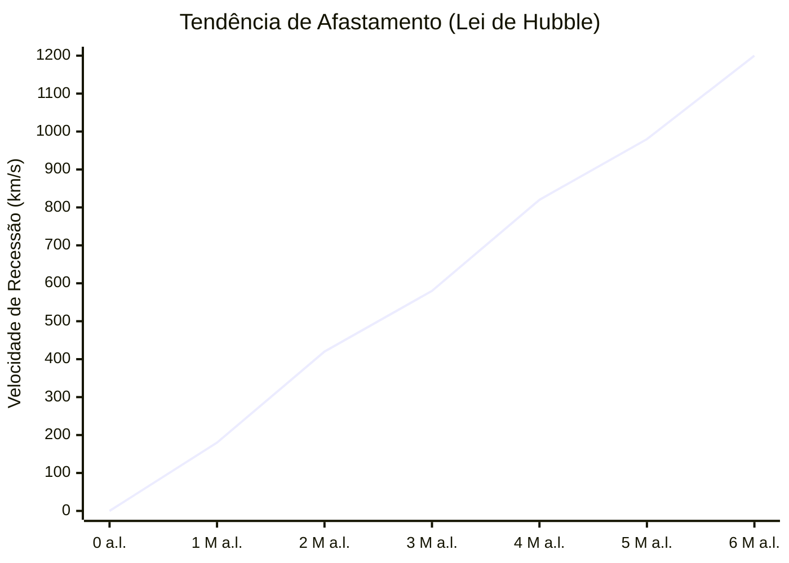

# Unidade 03 – Medidas de distância em Astronomia

## Lição 07 – Efeito de Doppler e o Diagrama de Hubble

Após compreendermos de que forma os astrónomos utilizam a luz e as estrelas Cefeidas como «réguas cósmicas» para aferir distâncias inimagináveis, debruçamo-nos agora sobre outra propriedade extraordinária da luz: a sua capacidade de nos revelar a velocidade e a direcção do movimento dos astros. Esta lição introduz o **Efeito de Doppler**, um fenómeno físico que culminou numa das maiores descobertas de toda a história da ciência.

### 1. O Efeito de Doppler no Som

O Efeito de Doppler é um fenómeno ondulatório com o qual lidamos frequentemente no nosso quotidiano urbano. O exemplo clássico evocado pelo docente é o de uma ambulância com a sirene ligada, ou de um automóvel a buzinar ininterruptamente enquanto transita por uma estrada.

Se o observador se encontrar imóvel na calçada:
*   Quando o veículo se **aproxima**, o som da buzina afigura-se mais agudo (frequência mais alta).
*   Quando o veículo passa e se **afasta**, o som da buzina torna-se subitamente mais grave (frequência mais baixa).

Este fenómeno não decorre de qualquer alteração mecânica na buzina do veículo. Quando uma fonte emissora de ondas se encontra parada, as cristas das ondas propagam-se de forma perfeitamente concêntrica e simétrica. Todavia, se a fonte se mover numa dada direcção, ela "persegue" as ondas que emite pela frente, comprimindo-as. Em contrapartida, as ondas emitidas para a retaguarda expandem-se e alongam-se.

O diagrama que se segue recria as ilustrações dos diapositivos, evidenciando o comportamento das frentes de onda:

```tikz
\begin{tikzpicture}[scale=1.2, transform shape]
    % Fundo
    \fill[white] (-7, -3) rectangle (7, 3);
    
    % Rótulo Observador O2 (Atrás) — movido mais para a esquerda
    \node[font=\bfseries, text=red, align=center] at (-4.5, 0) {O2\\(Atrás)};
    \draw[thick, red] (-3.8, 0) ellipse (0.2 and 0.1);
    \fill[red] (-3.8, 0) circle (0.05); % Olho O2
    
    % Rótulo Observador O1 (Frente) — movido mais para a direita
    \node[font=\bfseries, text=blue, align=center] at (4.5, 0) {O1\\(Frente)};
    \draw[thick, blue] (3.8, 0) ellipse (0.2 and 0.1);
    \fill[blue] (3.8, 0) circle (0.05); % Olho O1

    % Ondas comprimidas à frente e expandidas atrás (ajustadas)
    \foreach \i in {1, 2, 3, 4, 5, 6, 7, 8} {
        \draw[blue!70!black, thick] (\i*0.25, 0) circle (\i*0.35);
    }
    
    % Fonte (Carro/Sinal) — centrada entre os olhos
    \fill[red!90!black] (2.0, 0) circle (0.08);
    \draw[->, ultra thick, black] (2.0, 0.3) -- (2.8, 0.3) node[above, font=\scriptsize\bfseries] {v};

    % Anotações Explicativas — movidas para fora da zona de ondas
    \node[font=\bfseries, text=blue, align=center] at (4, -1.5) {Ondas\\Comprimidas\\(Agudo)};
    \node[font=\bfseries, text=red, align=center] at (-3.5, -1.5) {Ondas\\Alongadas\\(Grave)};
    
\end{tikzpicture}
```

*Nota: Para visualizar animações interactivas que espelham perfeitamente as simulações utilizadas nos diapositivos (e recomendadas pelo professor), sugere-se a visita ao artigo da Wikipédia sobre o tema: [https://en.wikipedia.org/wiki/Doppler_effect](https://en.wikipedia.org/wiki/Doppler_effect).*

### 2. O Desvio para o Vermelho e o Azul na Luz

Como explorámos na lição anterior, a luz não é mais do que uma onda electromagnética. Consequentemente, a luz está inexoravelmente sujeita ao mesmíssimo Efeito de Doppler que afecta o som. A grande diferença reside no facto de a velocidade dos nossos automóveis ser ínfima face à velocidade da luz, impedindo-nos de visualizar este fenómeno a olho nu no nosso trânsito citadino.

Contudo, quando observamos galáxias que viajam a milhares de quilómetros por segundo no abismo intergaláctico, o Efeito de Doppler luminoso torna-se não só visível, como perfeitamente mensurável:
*   **Aproximação ($v < 0$):** Se uma galáxia se desloca velozmente na direcção da Terra, as ondas de luz que ela emite são comprimidas. Visto que comprimentos de onda menores correspondem à parte azul do espectro visível, dizemos que a luz da galáxia sofre um **«desvio para o azul»** (*blueshift*).
*   **Afastamento ($v > 0$):** Se uma galáxia se afasta velozmente de nós, as suas ondas de luz são esticadas. Comprimentos de onda maiores pertencem à parte vermelha do espectro, pelo que apelidamos este fenómeno de **«desvio para o vermelho»** (*redshift*).

Quanto mais célere for o movimento de aproximação ou afastamento da galáxia, mais drástico e acentuado será, respectivamente, o seu azulamento ou avermelhamento. É exactamente a medição rigorosa desta alteração cromática no espectro luminoso que permite aos astrofísicos deduzir a velocidade vectorial de qualquer objecto cósmico.

### 3. O Diagrama de Hubble e a Orquestração do Cosmos

Regressemos à figura tutelar de **Edwin Hubble**. Após identificar as estrelas Cefeidas na Nebulosa de Andrómeda (M31) e em diversas outras galáxias recém-descobertas (determinando a sua distância absoluta), Hubble resolveu associar esses dados à velocidade dessas mesmas galáxias (medida através do desvio para o vermelho/azul).

O astrónomo norte-americano concebeu então um gráfico bidimensional que ficaria imortalizado como o **Diagrama de Hubble**:
*   No **eixo dos xx (horizontal)**, inseriu a **Distância** da galáxia (em milhões de anos-luz).
*   No **eixo dos yy (vertical)**, inseriu a **Velocidade** da galáxia (em $\mathrm{km/s}$).

Por convenção (que manteremos para facilitar a leitura), as velocidades positivas representam galáxias que se afastam, ocupando a região superior do gráfico (vermelha). As velocidades negativas ilustram astros em aproximação, ocupando a região inferior (azul).

```tikz
\begin{tikzpicture}[scale=1.3]
    % Áreas de Cor
    \fill[red!30] (0, 0) rectangle (7, 3.5);
    \fill[blue!30] (0, -1) rectangle (7, 0);
    
    % Linha de Velocidade Zero
    \draw[dashed, ultra thick, green!80!black] (0,0) -- (7,0);
    \node[left, font=\bfseries\Large, text=green!80!black] at (-0.15, 0) {0};
    
    % Eixos
    \draw[->, ultra thick, black] (0, -1) -- (0, 4.5);
    \draw[->, ultra thick, black] (0, -1) -- (8.2, -1);
    
    % Label do eixo Y — bem afastado para a esquerda
    \node[rotate=90, font=\bfseries] at (-1.2, 1.75) {Velocidade ($\mathrm{km/s}$)};
    
    % Label do eixo X — bem afastado para baixo
    \node[font=\bfseries] at (4.1, -1.8) {Distância ($\mathrm{anos-luz}$)};
    
    % Marcações nos eixos — números colados ao eixo
    \node[left, font=\bfseries] at (-0.15, 1.5) {500};
    \node[left, font=\bfseries] at (-0.15, 3.0) {1000};
    \node[below, font=\bfseries] at (3.5, -1.15) {$3 \times 10^6$};
    \node[below, font=\bfseries] at (7.0, -1.15) {$6 \times 10^6$};

    % Rótulos de Desvio
    \node[font=\bfseries\Large, text=red!80!black] at (5.5, 1.5) {$(v > 0)$};
    \node[font=\bfseries\Large, text=blue!80!black] at (5.5, -0.5) {$(v < 0)$};

    % Exemplo de Galáxia (Ponto Específico do Diapositivo)
    \fill[black] (3.5, 2.4) circle (0.08);
    \draw[dashed, thick, black!70] (3.5, -1) -- (3.5, 2.4) -- (0, 2.4);
    
    % Anotação
    \node[font=\scriptsize\bfseries, align=left, fill=white, inner sep=2pt, rounded corners=2pt] at (2.2, 2.8) {d = $3 \times 10^6$ a.l.\\v $\simeq 800$ $\mathrm{km/s}$};

    % Tendência de Hubble (Linha)
    \draw[ultra thick, purple!80!black] (0, 0) -- (7, 3.2);
    
    % Dispersão de Outras Galáxias (Ilustrativo)
    \foreach \x/\y in {0.5/-0.2, 0.8/-0.4, 1.2/0.1, 2.0/1.2, 2.5/1.5, 3.2/2.8, 4.0/1.8, 4.5/2.5, 5.0/2.2, 6.2/3.4, 6.8/3.0} {
        \fill[black!70] (\x, \y) circle (0.05);
        \draw[black] (\x, \y) circle (0.07);
    }
\end{tikzpicture}
```

Para complementar a representação visual, o seguinte gráfico linear sintetiza a tendência directa de proporcionalidade evidenciada no diagrama, onde as maiores distâncias induzem velocidades de recessão cada vez mais extremas:



### 4. As Conclusões Tectónicas de 1927

Ao debruçar-se sobre o seu diagrama contendo as galáxias então conhecidas, Hubble deparou-se com duas constatações assombrosas que redefiniriam a cosmologia para sempre:

1.  **Quase todas as galáxias se estão a afastar de nós.** Com a excepção de um reduzidíssimo punhado de galáxias vizinhas pertencentes ao nosso Grupo Local (como Andrómeda, que se aproxima muito lentamente da Via Láctea devido à atracção gravitacional mútua), a esmagadora maioria do universo observável apresenta desvio para o vermelho ($v > 0$).
2.  **Quanto mais distante está uma galáxia, mais rápido ela se afasta.** O gráfico não é aleatório; desenha uma linha recta ascendente perfeitamente clara.

Perante estes factos, surgiu o grande enigma analítico: *Terá a Via Láctea algo de especial? Estaremos nós no centro exacto de uma explosão cósmica da qual tudo o resto foge aterrorizado?*

O docente responde negativamente e recorre a uma metáfora sublime: a do autocarro. Se viaja num autocarro a $40\,\mathrm{km/h}$ e observa uma pessoa sentada, imóvel, numa paragem, a sua perspectiva fá-lo ver essa pessoa a afastar-se para trás a $40\,\mathrm{km/h}$. O movimento é estritamente relativo. Se houvesse astrónomos noutra galáxia distante a compilar o mesmo gráfico de Hubble, eles veriam exactamente o mesmo padrão: todas as galáxias, incluindo a nossa Via Láctea, a afastarem-se deles.

A única explicação plausível e logicamente inatacável para este facto é que **não são as galáxias que se movem como projécteis num espaço estático; é o próprio tecido do Universo, o próprio espaço entre as galáxias, que se encontra em expansão.** 

A quantidade de espaço vazio aumenta continuadamente. Assim sendo, quanto maior for a distância entre duas galáxias, maior será a quantidade de espaço a dilatar entre elas, originando uma velocidade de recessão aparente muito mais elevada. Foi este exacto raciocínio, alicerçado na luz e na matemática do Efeito de Doppler, que cimentou a prova cabal de que **não vivemos num Universo estático**, oferecendo à humanidade o primeiro e monumental pilar que sustentaria a futura teoria do «Big Bang».